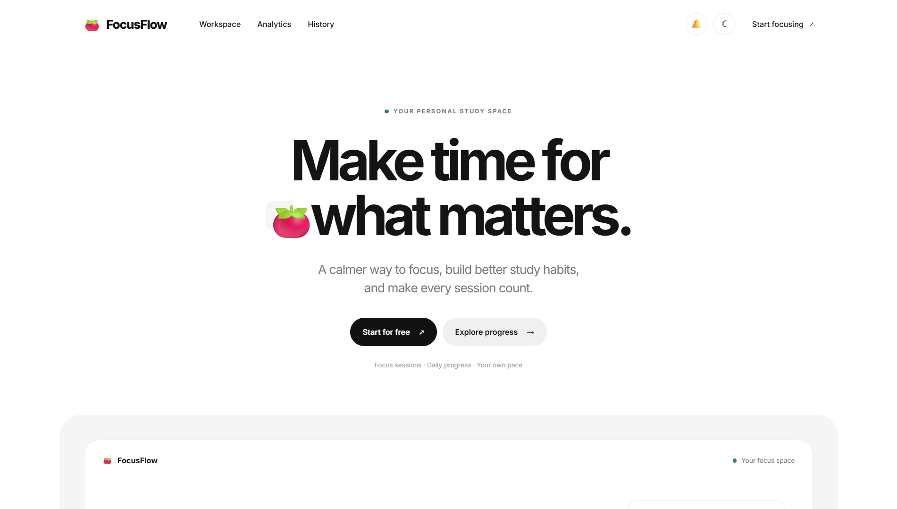
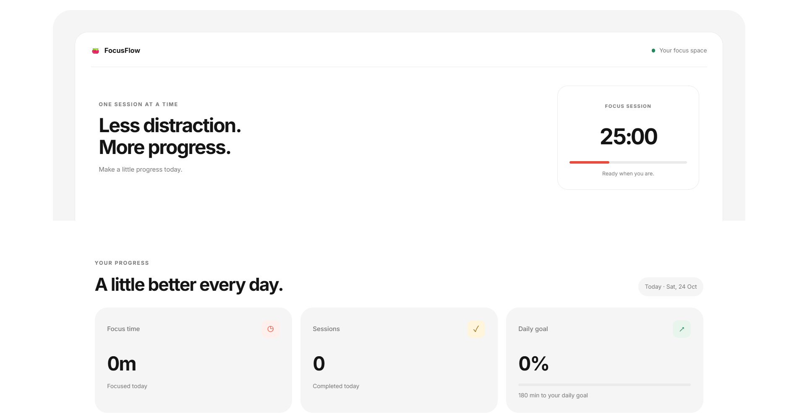
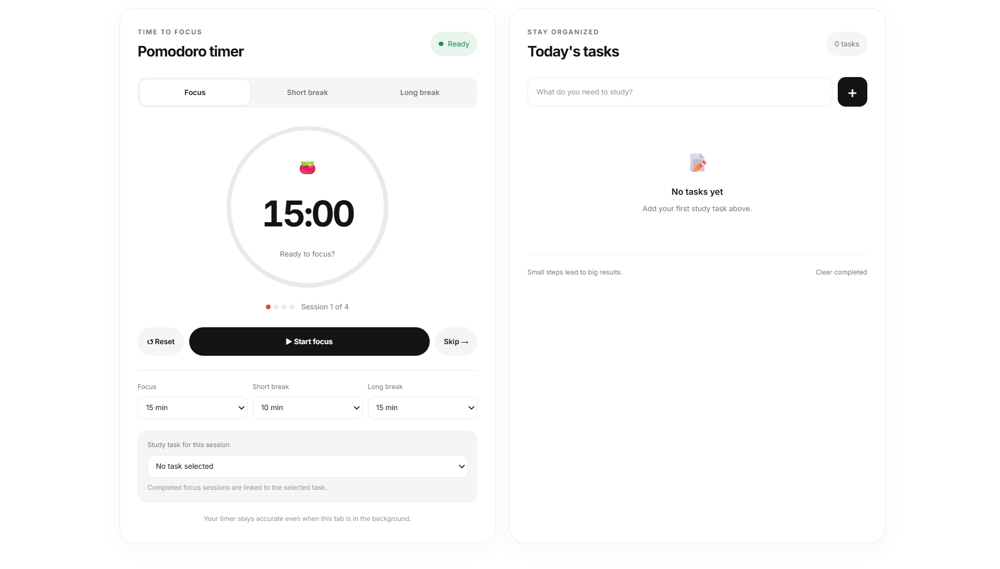
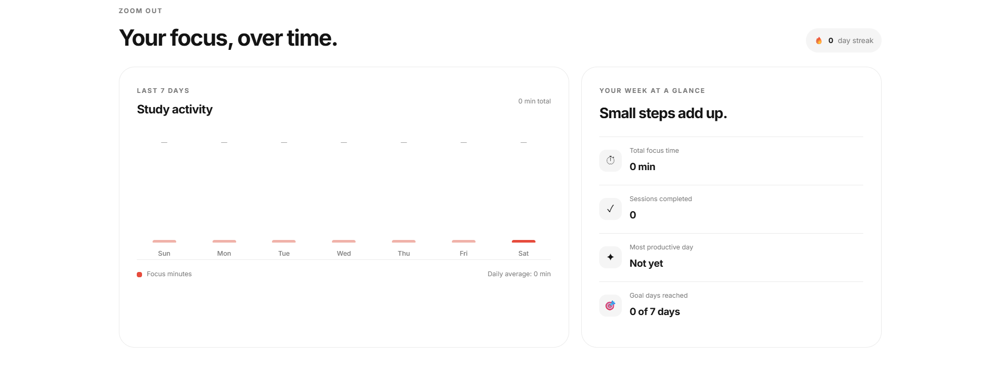
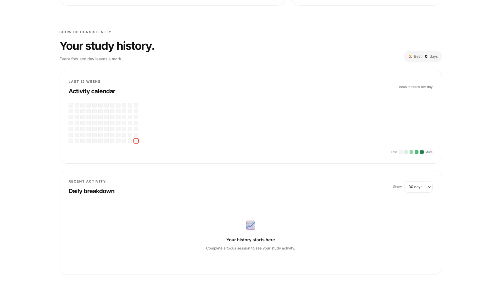
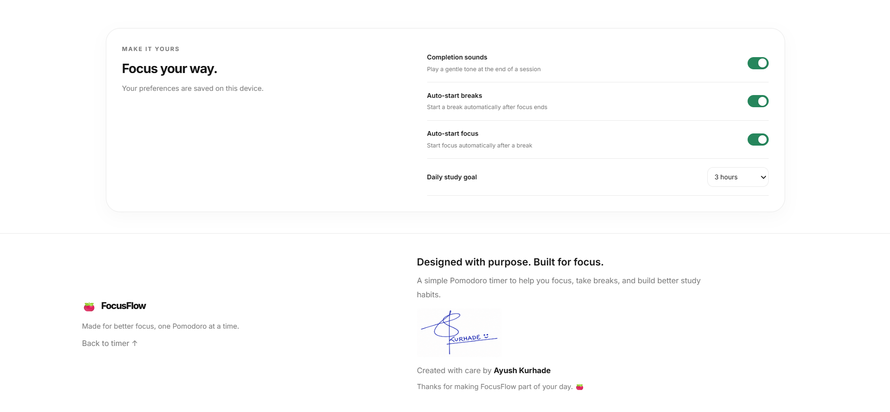

# 🍅 FocusFlow
 
**A calmer way to focus, study, and build better habits.**
 
FocusFlow is a Pomodoro study timer with task tracking, daily goals, weekly analytics, and a study history calendar. It runs entirely in the browser with no backend, no sign-up, and no dependencies. Your data stays on your device.
 
---
 
## 🧠 How It Works
 
1. **Pick a task** (optional) and press **Start** to begin a 25-minute focus session.
2. When the session ends, a short break begins. After 4 sessions you get a long break.
3. Every completed session is logged toward your daily goal, weekly chart, streaks, and history heatmap.
4. All data is stored locally in your browser under a single `localStorage` key.
> **Note:** Clearing your browser data will reset your progress, since nothing is stored on a server.
 
---
 
## 📚 What I Learned
 
- Building a complete app with **vanilla JavaScript**, with no frameworks
- **DOM manipulation** and managing app state for the timer, tasks, and stats
- Saving and loading data with **localStorage**
- Playing sounds with the **Web Audio API**
- Theming and **dark mode** using CSS variables
- Responsive layouts with **CSS Grid and Flexbox**
- Using **Git and GitHub** to commit, push, and publish a project
---
 
## 📸 Screenshots
 
### Homepage
A clean landing view that gets you into a focus session in one click.
 

 
### Dashboard
Your daily progress at a glance: focus time, sessions completed, and goal progress.
 

 
### Pomodoro Timer & Tasks
Start a focus session, pick a task, and adjust durations on the fly.
 

 
### Analytics
See how your focus time adds up over the last 7 days.
 

 
### Study History
A 12-week activity calendar and a daily breakdown to keep you consistent.
 

 
### Settings
Make it yours with sound, auto-start, and daily goal options.
 

 
---
 
## ✨ Features
 
| | Feature | What it does |
| :-: | --- | --- |
| ⏱️ | **Smart Focus Timer** | Focus, short break, and long break modes in a 4-session cycle, with custom durations |
| ✅ | **Task Planner** | Add today's study tasks and link one to each session |
| 🎯 | **Daily Goals** | Set a 1 to 6 hour goal and watch a live progress bar fill up |
| 📊 | **Weekly Analytics** | 7-day activity chart with daily average, best day, and goal days |
| 🔥 | **Streaks & Heatmap** | Current and best streaks, plus a 12-week activity calendar |
| 📅 | **Study History** | Filterable daily breakdown for 7, 14, 30 days, or 12 weeks |
| ⚙️ | **Your Way** | Completion sounds, auto-start breaks and focus, and dark mode |
| 💾 | **Private & Persistent** | Saved in your browser with `localStorage`, with no account or server |
| 📱 | **Fully Responsive** | Works on desktop, tablet, and mobile |
 
---
 
## 🛠️ Tech Stack
 
| Technology | Purpose |
| --- | --- |
| HTML5 | Structure and semantic markup |
| CSS3 | Layout, theming, animations, dark mode |
| Vanilla JavaScript | Timer logic, state, charts, storage |
| Web Audio API | Session completion tones |
| localStorage | Saving tasks, settings, and history |
| Google Fonts (Inter) | Typography |
 
---
 
## 📁 Project Structure
 
```
Focusflow-pomodoro/
├── assets/            # Screenshots and images
├── index.html         # Page structure
├── style.css          # Styles and theming
├── script.js          # App logic
└── README.md
```
 
---
 
## 🔮 Future Ideas
 
- Browser notifications when a session ends
- Keyboard shortcuts (start/pause, skip, reset)
- Export and import of study data
- Installable PWA with offline support
---
 
## 👤 Author
 
**Ayush Kurhade**
 
- GitHub: [@AyushKurhade](https://github.com/AyushKurhade)
 
---
 
## 📄 License
 
This project is open source and available for personal and educational use.
 
---
 
⭐ If you find FocusFlow useful, consider giving the repo a star!

This project is open source and available for personal and educational use.

---